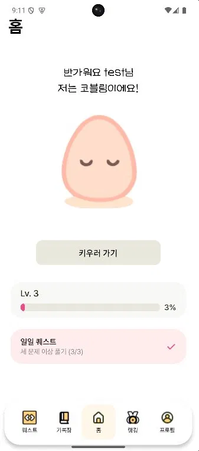
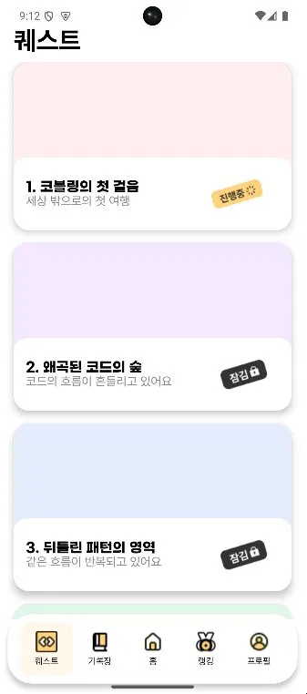
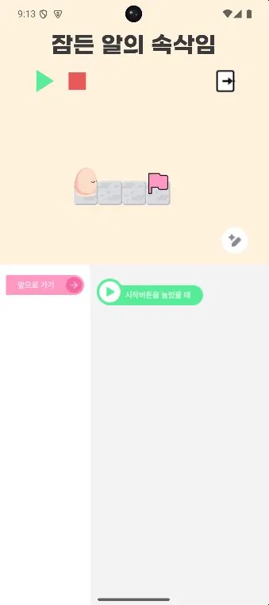
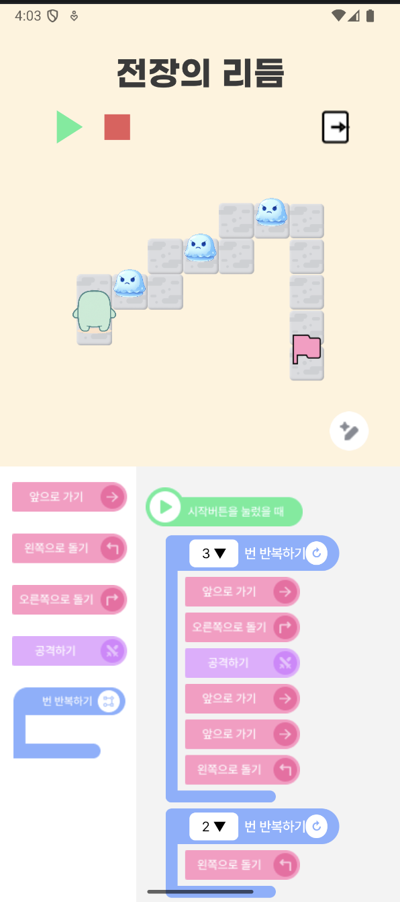

# 🧩 Cobling (코블링)

### Kotlin & Firebase 기반 게임형 블록코딩 학습 애플리케이션

초·중학생이 게임을 통해 코딩의 기본 개념을 학습할 수 있도록 개발한 Android 애플리케이션입니다.

## 프로젝트 소개

- **개발 기간:** 2026년 졸업작품
- **개발 인원:** 4명
- **담당 역할:** 팀장 및 Firebase 백엔드 개발
- **개발 환경:** Android Studio

## 기술 스택

**Android**
- Kotlin
- Jetpack Compose
- Material3
- MVVM
- Hilt

**Backend**
- Firebase Authentication
- Cloud Firestore
- Firebase Cloud Messaging
- Cloud Functions (별도 서버 프로젝트)

## 주요 기능

- 이메일 회원가입 및 로그인
- 블록코딩을 활용한 퀘스트 수행
- 퀘스트 진행도 저장 및 관리
- 경험치(EXP), 골드, 레벨업 시스템
- 퀘스트 완료 시 보상 지급
- Firebase 기반 알림 기능

## 담당 업무

- 프로젝트 팀장으로서 개발 일정 및 협업 관리
- Firebase Authentication 연동
- Firestore 데이터 구조 및 사용자 정보 관리
- 퀘스트 진행도와 보상 처리 기능 개발
- Firebase 연동 및 오류 해결

## 프로젝트 화면

앱 스크린샷 추가 예정

## 개선 계획

- Firestore 보상 처리 동시성 개선
- Firebase Security Rules 강화
- 자동화 테스트 추가

## 프로젝트 포트폴리오

포트폴리오 PDF 링크 추가 예정

## 📱 프로젝트 실행 화면

### 1. 홈 화면

### 2. 퀘스트 목록

### 3. 기초 블록코딩

### 4. 블록코딩 전투

